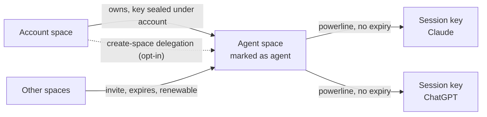
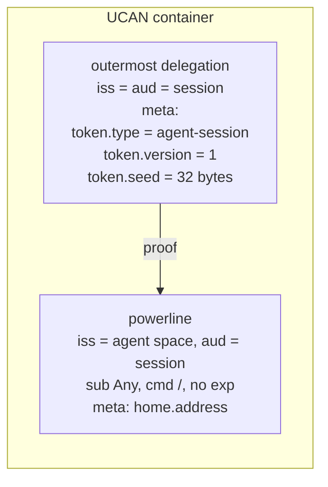
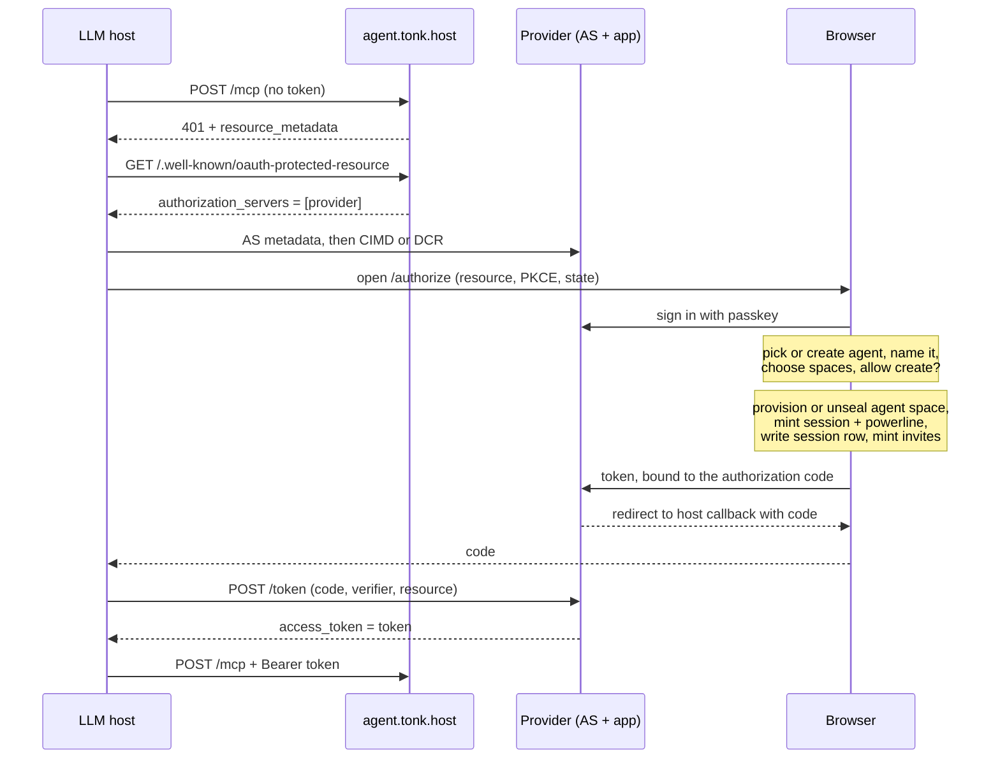
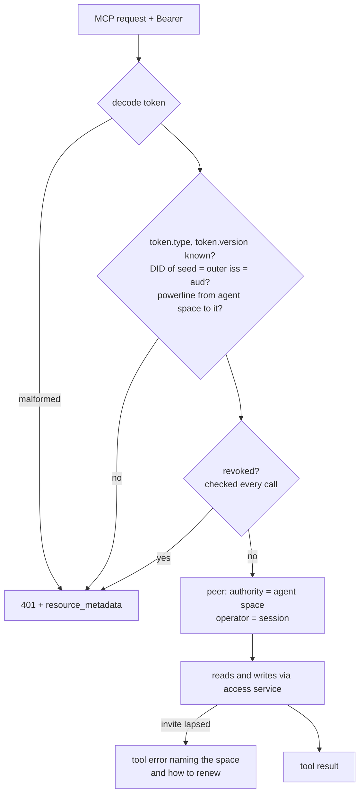
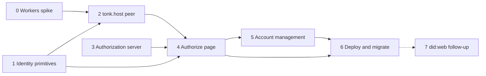

# Hosted agent peer (tonk.host)

Status: design agreed 2026-10-28, implementation not started. Replaces the
per-call agent-link MCP (#1105).

An agent gets its own space, provisioned by the user's account during an OAuth
sign-up. The OAuth token is a session credential for that space. Every MCP call
goes to `agent.tonk.host` carrying the token; the handler builds a dialog peer
for the agent and acts with full fidelity: list its spaces, see contacts (the
account it works for among them), query, evaluate, create spaces when allowed.
`tonk.host` is a multi-tenant hosted peer. The MCP server is a thin wrapper.

## Model



- **Agent space.** An ordinary space, provisioned through the user's account and
  sealed under it like any other (dialog-credentials). Accounts are spaces too,
  so an agent space DID is a valid member, audience and contact anywhere an
  account DID is. A space entry marks it as an agent space.
- **Session.** A fresh keypair per OAuth authorization. The agent space delegates
  to it with a powerline (`sub: Any`, command `/`), **no expiry**, the same shape
  as `mint_addressed_device_delegation`. Valid until revoked.
- **Access to other spaces** is by invite to the agent space DID. Invites expire
  and are renewed like any other invite. This is where expiry lives.
- **Space creation** (opt-in at authorization): a delegation from the account
  letting the agent provision spaces on the user's behalf. Created spaces are
  owned by the user and sealed under the account.
- **Attribution.** Authority is the agent space DID, operator is the session DID.
- **Identifier.** `did:key` through stage 6. Naming agent spaces by `did:web`
  is a follow-up (stage 7).

### Identifier (follow-up)

```
did:key:z6Mk...            agent space key
did:web:tonk.host:agent:z6Mk...
  └─ GET https://tonk.host/agent/z6Mk.../did.json
```

The document is derived from the key: one `verificationMethod` for the embedded
key, `alsoKnownAs` the `did:key`, and a `service` entry pointing at the hosted
peer. Resolvers **must** check that the document's key is the one embedded in
the identifier, so whoever controls `tonk.host` cannot rotate an agent's key.
With that check, `did:web` adds a name, discovery of the hosted peer and a
place to mark an agent deactivated, without adding trust in DNS.

The access service already verifies chains issued by `did:web` identities
(`dialog_did_web::CachingResolver` in `handlers/ucan.rs`). The embedded-key
check is new.

`tonk.host` serves these documents and nothing else: it must never serve sign-in,
because every `*.tonk.host` page can claim `tonk.host` as its WebAuthn RP ID.

A leaked token exposes the agent's own space plus whatever invites are live at
the time. Revocation is the only bound on the session itself.

## Token

A UCAN container (base64url), the same encoding everything else uses. The
outermost delegation says what the token is and carries the seed:



The outermost delegation is issued by the session to itself, so it authorizes
nothing on its own. tonk.host reads `token.*` from its `meta`, derives the key
from the seed and checks that its DID is both issuer and audience. Invocations
use only the powerline as proof, and only the powerline is retained in the
agent space (the session row), so the seed is never stored or sent to a
verifier.

The token response has no `expires_in` and no `refresh_token`. This departs
from the spec's SHOULD on short-lived tokens; expiry is on invites, revocation
on the session.

## Authorization

Resource server and authorization server are separate origins, as the MCP
authorization spec allows. The authorize page must be on the provider origin
because that is where the user's passkey works. `/settings/link` (sign-in via
another deployment) is the existing precedent for this kind of approval page.



The browser does all key work: provisioning or unsealing the agent space,
minting the session and powerline, writing the session row, minting invites and
the optional create-space delegation. The AS only stores the finished token
against the code. The code is single-use and short-lived; `/token` checks PKCE
(S256), `redirect_uri`, and that `resource` is this channel's
`agent*.tonk.host/mcp`, then returns the token once.

## Request handling



- Stateless Worker. No container, no replicas, no checkpoints. Any number of
  instances; concurrent writes resolve at the revision cell.
- A verified powerline can be cached by token hash indefinitely (it cannot
  expire). Revocation is never cached.
- A lapsed invite is a tool error, not a 401: a 401 makes the host mint a new
  session instead of renewing anything.
- Reads go through the access service. Revisit direct R2 only if it measures slow.

## Records

In the agent space, mirroring how the account space records devices:

- **Agent marker.** A space entry marking it as an agent space.
- **Session rows.** Same shape as `account/device-link`: keyed by the powerline's
  blob hash, `created-at`, `title` (OAuth `client_name`, e.g. "Claude"),
  `reason: case:agent-session`. Revoking the powerline removes the row.

New concepts go in the YAML library first (`schema-first`).

## Channels

| Channel | MCP (resource server) | Authorization server |
| --- | --- | --- |
| main | `https://agent-dev.tonk.host/mcp` | `https://tonk.foundation` |
| staging | `https://agent-staging.tonk.host/mcp` | `https://staging.tonk.xyz` |
| stable | `https://agent.tonk.host/mcp` | `https://tonk.network` |
| PR N | `tonk-mcp-pr-N.<subdomain>.workers.dev/mcp` | matching preview |

## Implementation

Each stage ends in a milestone that can be shown working on localhost. Stages
0, 1 and 3 can start in parallel; stage 0 gates the architecture of stage 2.



### Stage 0: dialog peer in a Workers isolate

Prove the stateless design before building on it.

- Build a minimal workers-rs Worker embedding the peer (`tonk-worker` already
  targets `wasm32` for the browser). Hardcode a seed and powerline.
- Through the access service: list spaces, run a query, run an evaluation.
- Measure compressed bundle size against the Workers limit, peak memory against
  128 MB, cold start, and CPU on the largest real space we have.

**M0:** go/no-go with numbers. Fallback if no-go: keep the container, but
stateless per call (no replicas or checkpoints), and revisit.

### Stage 1: identity primitives

Rust, in `tonk-identity`, `tonk-schema` and the YAML library.

- Concepts: agent marker and `agent-session` row (mirror `account/device-link`).
- `mint_agent_session(agent_space, session_did, home)`: powerline, no expiry.
- Token as a UCAN container: outermost session-to-session delegation with
  `token.type`, `token.version`, `token.seed` in `meta`, the powerline as its
  proof. Tests: round trip; unknown type or version refused; seed DID must match
  issuer and audience; the retained powerline and the proofs sent on invocation
  never contain the seed.
- Provision an agent space under an account (reuse space creation and sealing).
- Create-space delegation, once open question 1 is decided.
- CLI: `tonk agent create --name`, `tonk agent session` printing a token,
  `tonk agent revoke`. This gives stage 2 real tokens without OAuth.

**M1:** from the CLI, create an agent, invite it to a space, mint a token,
decode and verify it, revoke it.

### Stage 2: tonk.host peer (resource server)

Replace `mcp/agent-link-backend.mjs` and `mcp/hosted/agent-service.mjs` with a
Worker that takes a Bearer token.

- Decode, verify, revocation check, construct the peer (authority and operator).
- Tools: `tonk_query` and `tonk_evaluate` addressed by `space` instead of
  `agent_link`; list spaces; contacts; join from a pasted ticket; create space
  when delegated. Keep `mcp/primitive.mjs` notation semantics.
- `401` with `WWW-Authenticate: Bearer resource_metadata=...`; tool errors for
  lapsed invites.
- Serve `/.well-known/oauth-protected-resource` naming the channel's provider.
- `providerOrigin()` localhost exception for local development.
- Tests: missing, malformed, wrong-audience and revoked tokens; concurrent writes
  from two sessions of one agent; a lapsed invite.

**M2:** Claude Code against `wrangler dev`, with the CLI token as a static
header (`claude mcp add --transport http --header "Authorization: Bearer ..."`),
lists spaces, queries and writes in a space the agent was invited to.

### Stage 3: authorization server

On the access service (Rust).

- `/.well-known/oauth-authorization-server`: `code_challenge_methods_supported:
  [S256]`, `client_id_metadata_document_supported: true`, `registration_endpoint`.
- Client ID Metadata Documents and dynamic registration. Accept
  `http://localhost:<port>` callbacks. Pre-#1105 `mcp/hosted/oauth.mjs`,
  `registration.mjs` and `cloudflare/discovery.mjs` are reference.
- `/authorize`: validate, then hand off to the app route (stage 4).
- Code store: single use, short TTL, holding the token, PKCE challenge,
  `redirect_uri`, `resource`. If D1, a migration plus the `control-schema` doc.
- `/token`: check PKCE, `redirect_uri`, `resource`; return the token once.
- Tests: replayed code, wrong verifier, wrong resource, wrong redirect, expired code.

**M3:** MCP Inspector completes discovery and the OAuth dance against the local
stack using a stub approval page that returns a CLI-minted token, and the token
works at tonk.host.

### Stage 4: authorize page

In `tonk-ui` on the provider origin, modelled on `/settings/link`.

- Sign in with passkey. Show the client name **and the redirect host** (the spec
  requires showing the host; localhost-only callbacks get a warning).
- New or existing agent; name; choose spaces; allow space creation.
- On approve, the browser steps from Authorization, then post the token to the
  AS bound to the code.
- Playwright with Chrome's virtual authenticator (`hasPrf: true`).

**M4:** Claude Code runs the real flow on localhost: browser opens, user approves,
tools work, with no static header.

### Stage 5: account management

- List agents and their sessions (title, created, last used); revoke a session;
  revoke an agent (all sessions); manage its invites; toggle space creation.
- Last used: throttled write from tonk.host, at most once a day per session.
- Renewal of an agent's lapsed invites, per open question 5.

**M5:** revoking a session on the account page makes its next call return 401;
revoking an agent does so for all its sessions.

### Stage 6: deploy and migrate

- Deployment config: Worker only. Drop the container, the `TonkRuntime` Durable
  Object and the checkpoint buckets. Keep the channel domains.
- Smoke: PRM served, 401 carries `resource_metadata`, AS metadata reachable, and a
  CLI-minted token for a fixture agent can query.
- Agent-link callers: tools still sent `agent_link` get an error telling them to
  reconnect with OAuth. Remove the agent-link backend after one release.
- Acceptance on `agent-dev.tonk.host`: claude.ai, Claude Code, ChatGPT. Then
  staging, then stable.

**M6:** claude.ai connected to `agent-dev.tonk.host` through the real OAuth flow,
working in a space it was invited to.

### Stage 7 (follow-up): did:web identifiers

After the core flow ships. Settle open questions 5 and 6 first.

- `did:web:tonk.host:agent:{key}` derivation and document builder.
- Embedded-key check in the resolver used by the access service and peers.
- Serve `/agent/{key}/did.json`, with a deactivated flag for revoked agents.
- Decide whether existing agents are renamed or keep `did:key`.

**M7:** an invite addressed to an agent's `did:web` verifies, and the document
resolves with the embedded-key check enforced.

## Local development

| Piece | How |
| --- | --- |
| AS + app | access service under `wrangler dev`; see the `run-app` skill |
| tonk.host | `wrangler dev` on another port |
| Real client | `claude mcp add --transport http tonk-local http://localhost:<port>/mcp` |
| Step-through | `npx @modelcontextprotocol/inspector` |
| Automated | Playwright + Chrome virtual authenticator, Node MCP SDK client |
| claude.ai | `cloudflared tunnel --url` per origin; passkeys are per tunnel hostname |

## Open

1. **Create-space delegation.** Narrow command or powerline from the account?
   Quota? Permanent and unbounded means a leaked token can create spaces the
   user pays for. Blocks the last item of stage 1.
2. **Finding agents.** Does the account page list agent spaces from the account's
   space list filtered by the marker, or keep a pointer in the account space?
   Decides whether agents show up among ordinary spaces. Needed by stage 5.
3. **Workers fit.** Answered by stage 0.
4. **Invite renewal.** Who renews an agent's lapsed invite, and how the agent
   learns which one lapsed. Needed by stage 5.
5. **`did:web` as principal or alias.** As principal, the powerline issuer,
   invite audiences and contacts use the `did:web`, and every verifier resolves
   it (offline peers need the embedded-key shortcut to avoid a fetch). As alias,
   UCANs keep the `did:key` and the `did:web` is for naming and discovery only.
   Also: does the space's storage subject stay `did:key` either way? Needed by
   stage 7.
6. **Channels in the identifier.** `did:web:tonk.host:...` names the stable host
   for agents provisioned on dev and staging too. Either `tonk.host` serves
   documents for every channel (the key part is derivable, but the service entry
   and deactivation are per channel), or the host is per channel, e.g.
   `did:web:agent-dev.tonk.host:agent:...`. Needed by stage 7.
