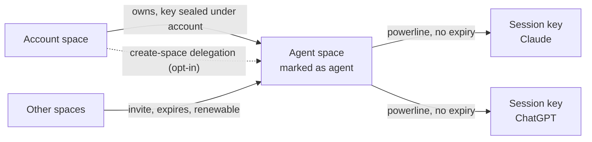
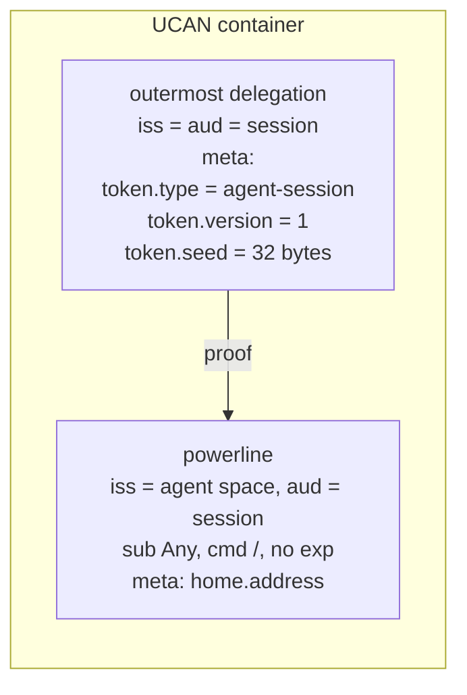
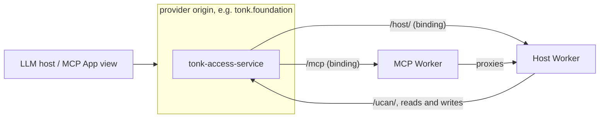
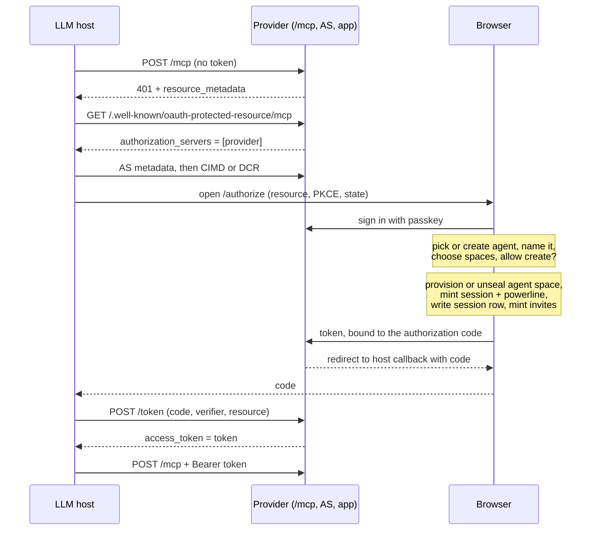
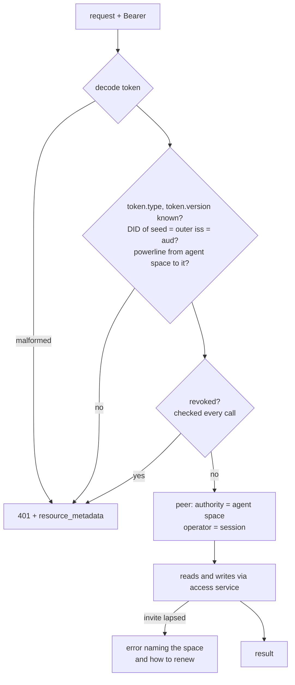
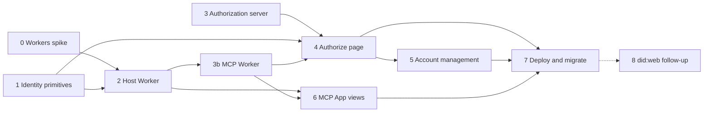

# Hosted agent peer

Status: design agreed 2026-10-28, implementation not started. Replaces the
per-call agent-link MCP (#1105).

An agent gets its own space, provisioned by the user's account during an OAuth
sign-up. The OAuth token is a session credential for that space. Every call
carries the token; the handler builds a dialog peer for the agent and acts with
full fidelity: list its spaces, see contacts (the account it works for among
them), query, subscribe, transact, store and read assets, create spaces when
allowed.

Two surfaces on the provider origin, each its own Worker behind a service binding:

- `/host/` is the hosted peer: a space's origin API, mounted per space.
- `/mcp` is MCP, a thin wrapper that proxies to `/host/`.

## Model



- **Agent space.** An ordinary space, provisioned through the user's account and
  sealed under it like any other (dialog-credentials). Accounts are spaces too,
  so an agent space DID is a valid member, audience and contact anywhere an
  account DID is. A space entry marks it as an agent space.
- **Session.** A fresh keypair per OAuth authorization. The agent space delegates
  to it with a powerline (`sub: Any`, command `/`), **no expiry**, the same shape
  as `mint_addressed_device_delegation`. Valid until revoked.
- **Access to other spaces** is by invite to the agent space DID. Invites expire
  and are renewed like any other invite.
- **Space creation** (opt-in at authorization): a delegation from the account
  letting the agent provision spaces on the user's behalf. Created spaces are
  owned by the user and sealed under the account.
- **Attribution.** Authority is the agent space DID, operator is the session DID.
- **Identifier.** `did:key`. Naming agents by `did:web` is a follow-up (stage 8).

### Permanent session delegations

Sessions are deliberately permanent, revoked rather than expired:

- **Expiry lives where it bounds damage.** A session reaches other spaces only
  through invites, and those expire. A leaked token exposes the agent's own space
  plus whatever invites are live.
- **Renewal would need the user.** The agent space key is sealed under the
  account, so only the user's browser can mint a new powerline. Expiring
  sessions mean periodic re-authorization through the LLM host, or a long-lived
  key held server-side for refresh. Neither is better than revocation.
- **Same as devices.** Device authorizations are permanent powerlines too.
- **Revocation is checked on every call** and each session is listed on the
  account page, so a session can be found and cut off.

The token response has no `expires_in` and no `refresh_token`.

## Token

A UCAN container (base64url), the same encoding everything else uses. The
outermost delegation says what the token is and carries the seed:



The outermost delegation is issued by the session to itself, so it authorizes
nothing on its own. `/host/` reads `token.*` from its `meta`, derives the key
from the seed and checks that its DID is both issuer and audience. Invocations
use only the powerline as proof, and only the powerline is retained in the
agent space (the session row), so the seed is never stored or sent to a
verifier.

## Endpoints



- The channel comes from the host: `tonk.foundation` is main, `staging.tonk.xyz`
  staging, `tonk.network` stable, each PR preview its own. Authorization server
  and resource server are the same origin.
- `tonk-access-service` forwards `/mcp` and `/host/*` through two service
  bindings. MCP and host deploy and scale on their own.
- The app's service worker must let `/mcp` and `/host/` bypass it (next to `/@`),
  so a tab opened on them is not handed the app shell.
- `/mcp` and `/host/` are separate because Streamable HTTP clients `POST`
  JSON-RPC with `Accept: application/json, text/event-stream`; a notation `POST`
  with SSE on the same path could only be told apart by its body.

### `/host/{space}/`

Mounts what a space's own origin answers (`tonk-kernel/src/site.rs`, #1201)
under a per-space prefix, authorized by the Bearer token instead of the origin:

| Request | Same as on the space origin |
| --- | --- |
| `/host/{space}/api/...` | the worker API: query (SSE with `Accept: text/event-stream`), evaluate, transact |
| `PUT /host/{space}/` | store an asset; `201`, `Location: /host/{space}/asset:{hash}` |
| `GET`/`HEAD /host/{space}/asset:{hash}` | read an asset, `Range` supported |
| `GET /host/{space}/{path}` | the content the space's routes keep at `{path}` (views) |

Space origins exist so each space is its own origin; `/host/` puts every space
on the provider origin, which also holds the account and its passkeys. So:

- **Every HTML response from `/host/` carries `Content-Security-Policy: sandbox
  allow-scripts allow-forms`** (no `allow-same-origin`): an opaque origin even
  when opened directly. Space content must never run as the provider origin.
- CORS allows opaque-origin callers (`Origin: null`) with a Bearer header and no
  cookies.

## Authorization

The authorize page is on the provider origin because that is where the user's
passkey works. `/settings/link` (sign-in via another deployment) is the existing
precedent for this kind of approval page.



The browser does all key work. The AS only stores the finished token against the
code. The code is single-use and short-lived; `/token` checks PKCE (S256),
`redirect_uri`, and that `resource` is this origin's `/mcp`, then returns the
token once.

## Request handling



- Stateless Worker. No container, no replicas, no checkpoints. Any number of
  instances; concurrent writes resolve at the revision cell.
- A verified powerline can be cached by token hash indefinitely. Revocation is
  never cached.
- A lapsed invite is an error naming the space (a tool error through `/mcp`),
  not a 401: a 401 makes the host mint a new session instead of renewing anything.
- Reads go through the access service. Revisit direct R2 only if it measures slow.

## Views in MCP Apps

The OAuth token stays in the LLM host; an MCP App view never sees it. A tool that
renders a view mints a **view credential** and returns it to the view:

- A short-lived delegation from the session to an ephemeral key, one space,
  read-only unless the view writes. Precedent: `mcp/hosted/space-session.mjs`
  (10 minutes, space only), renewed while the view is open.
- Delivered in the tool result's `_meta`, not in `content`, so the model does not
  read it.
- The view calls `/host/{space}/` with it directly. `apps/ui.mjs` already declares
  the provider origin in `_meta.ui.csp.connectDomains`.
- **Subscriptions over SSE work** with `fetch` and a streamed body, which can send
  `Authorization`. `EventSource` cannot set headers, so it is not used; the
  credential never goes in a URL.

This is the one place credentials are short-lived: they live in a browser frame
the user does not manage.

## Records

In the agent space, mirroring how the account space records devices:

- **Agent marker.** A space entry marking it as an agent space.
- **Session rows.** Same shape as `account/device-link`: keyed by the powerline's
  blob hash, `created-at`, `title` (OAuth `client_name`, e.g. "Claude"),
  `reason: case:agent-session`. Revoking the powerline removes the row.

New concepts go in the YAML library first (`schema-first`).

## Channels

| Channel | MCP | Host |
| --- | --- | --- |
| main | `https://tonk.foundation/mcp` | `https://tonk.foundation/host/` |
| staging | `https://staging.tonk.xyz/mcp` | `https://staging.tonk.xyz/host/` |
| stable | `https://tonk.network/mcp` | `https://tonk.network/host/` |
| PR N | preview origin `/mcp` | preview origin `/host/` |

`agent*.tonk.host` (#1110) is retired.

## Implementation

Each stage ends in a milestone that can be shown working on localhost. Stages
0, 1 and 3 can start in parallel; stage 0 gates the architecture of stage 2.



### Stage 0: dialog peer in a Workers isolate

Prove the stateless design before building on it.

- Build a minimal workers-rs Worker embedding the peer (`tonk-worker` already
  targets `wasm32` for the browser). Hardcode a seed and powerline.
- Through the access service: list spaces, query, subscribe, evaluate, store and
  read an asset.
- Measure compressed bundle size against the Workers limit, peak memory against
  128 MB, cold start, and CPU on the largest real space we have.

**M0:** go/no-go with numbers. Fallback if no-go: a container, stateless per
call (no replicas or checkpoints), and revisit.

### Stage 1: identity primitives

Rust, in `tonk-identity`, `tonk-schema` and the YAML library.

- Concepts: agent marker and `agent-session` row (mirror `account/device-link`).
- `mint_agent_session(agent_space, session_did, home)`: powerline, no expiry.
- Token as a UCAN container: outermost session-to-session delegation with
  `token.type`, `token.version`, `token.seed` in `meta`, the powerline as its
  proof. Tests: round trip; unknown type or version refused; seed DID must match
  issuer and audience; the retained powerline and the proofs sent on invocation
  never contain the seed.
- Provision an agent space under an account (reuse space creation and sealing).
- Create-space delegation, once open question 1 is decided.
- CLI: `tonk agent create --name`, `tonk agent session` printing a token,
  `tonk agent revoke`. This gives later stages real tokens without OAuth.

**M1:** from the CLI, create an agent, invite it to a space, mint a token,
decode and verify it, revoke it.

### Stage 2: Host Worker (`/host/`)

- Decode, verify, revocation check, construct the peer (authority and operator).
- Mount the space-origin surface per space (see `/host/{space}/`): worker API
  with SSE, `PUT /` assets, `/asset:{hash}` with `Range`, route content. Reuse
  the kernel's rewrite onto the worker's routes rather than reimplementing it.
- CSP sandbox on every HTML response; CORS for opaque origins.
- Agent-level reads: the agent's spaces and contacts.
- Service binding from `tonk-access-service`; service worker bypass for `/host/`.
- Tests: missing, malformed, wrong-audience and revoked tokens; concurrent writes
  from two sessions of one agent; a lapsed invite; a `Range` read; an SSE
  subscription receiving a change; HTML served sandboxed.

**M2:** with a CLI token and `curl`, list the agent's spaces, subscribe to a
query over SSE, write from a second shell and see the event, store and range-read
an asset.

### Stage 3: authorization server

On the access service (Rust).

- `/.well-known/oauth-protected-resource/mcp` naming this origin.
- `/.well-known/oauth-authorization-server`: `code_challenge_methods_supported:
  [S256]`, `client_id_metadata_document_supported: true`, `registration_endpoint`.
- Client ID Metadata Documents and dynamic registration. Accept
  `http://localhost:<port>` callbacks. Pre-#1105 `mcp/hosted/oauth.mjs`,
  `registration.mjs` and `cloudflare/discovery.mjs` are reference.
- `/authorize`: validate, then hand off to the app route (stage 4).
- Code store: single use, short TTL, holding the token, PKCE challenge,
  `redirect_uri`, `resource`. If D1, a migration plus the `control-schema` doc.
- `/token`: check PKCE, `redirect_uri`, `resource`; return the token once.
- Tests: replayed code, wrong verifier, wrong resource, wrong redirect, expired code.

**M3:** MCP Inspector completes discovery and the OAuth dance against the local
stack using a stub approval page that returns a CLI-minted token.

### Stage 3b: MCP Worker (`/mcp`)

Replaces `mcp/agent-link-backend.mjs`, `mcp/hosted/agent-service.mjs` and the
container.

- Bearer token passed through to `/host/` over the binding.
- Tools: `tonk_query` and `tonk_evaluate` addressed by `space` instead of
  `agent_link`; list spaces; contacts; join from a pasted ticket; create space
  when delegated. Keep `mcp/primitive.mjs` notation semantics.
- `401` with `WWW-Authenticate: Bearer resource_metadata=...`; tool errors for
  lapsed invites.
- Service binding from `tonk-access-service`; service worker bypass for `/mcp`.

**M3b:** Claude Code against the local stack with the CLI token as a static
header (`claude mcp add --transport http --header "Authorization: Bearer ..."`)
lists spaces, queries and writes in a space the agent was invited to.

### Stage 4: authorize page

In `tonk-ui` on the provider origin, modelled on `/settings/link`.

- Sign in with passkey. Show the client name **and the redirect host** (the spec
  requires showing the host; localhost-only callbacks get a warning).
- New or existing agent; name; choose spaces; allow space creation.
- On approve, the browser steps from Authorization, then post the token to the
  AS bound to the code.
- Playwright with Chrome's virtual authenticator (`hasPrf: true`).

**M4:** Claude Code runs the real flow on localhost: browser opens, user approves,
tools work, with no static header.

### Stage 5: account management

- List agents and their sessions (title, created, last used); revoke a session;
  revoke an agent (all sessions); manage its invites; toggle space creation.
- Last used: throttled write from `/host/`, at most once a day per session.
- Renewal of an agent's lapsed invites, per open question 4.

**M5:** revoking a session on the account page makes its next call return 401;
revoking an agent does so for all its sessions.

### Stage 6: MCP App views

- View credential: session to ephemeral key, one space, minutes, renewed while
  open. Minted by the tool that renders the view, returned in `_meta`.
- `/host/` accepts view credentials alongside session tokens.
- View runtime: `fetch` with streamed SSE for subscriptions, assets by
  `/host/{space}/asset:{hash}`, route content in a sandboxed frame.
- `apps/ui.mjs` CSP: `connectDomains` and `frameDomains` are the provider origin.

**M6:** in Claude Code or the MCP Apps reference host, a tool renders a live view
of a space; a write from the CLI shows up in the view without a tool call.

### Stage 7: deploy and migrate

- Deployment config: MCP and Host Workers, bound into each channel's access
  service. Drop the container, the `TonkRuntime` Durable Object, the checkpoint
  buckets and the `agent*.tonk.host` custom domains.
- Smoke: PRM served, 401 carries `resource_metadata`, AS metadata reachable, a
  CLI-minted token for a fixture agent can query through `/mcp` and `/host/`.
- Agent-link callers: tools still sent `agent_link` get an error telling them to
  reconnect with OAuth. Remove the agent-link backend after one release.
- Acceptance on `tonk.foundation`: claude.ai, Claude Code, ChatGPT. Then staging,
  then stable.

**M7:** claude.ai connected to `tonk.foundation/mcp` through the real OAuth flow,
working in a space it was invited to, with an inline view.

### Stage 8 (follow-up): did:web identifiers

```
did:key:z6Mk...                       agent space key
did:web:tonk.network:agent:z6Mk...
  └─ GET https://tonk.network/agent/z6Mk.../did.json
```

Same pattern as `did:web:tonk.network:customer:...`, so each channel names its
own agents. The document is derived from the key: one `verificationMethod` for
the embedded key, `alsoKnownAs` the `did:key`, a `service` entry for `/host/`.

- Resolvers **must** check that the document's key is the one embedded in the
  identifier, so whoever controls the host cannot rotate an agent's key. The
  access service already verifies chains from `did:web` issuers
  (`dialog_did_web::CachingResolver`); the embedded-key check is new.
- Serve `/agent/{key}/did.json`, with a deactivated flag for revoked agents.
- Decide whether existing agents are renamed or keep `did:key`.

**M8:** an invite addressed to an agent's `did:web` verifies, and the document
resolves with the embedded-key check enforced.

## Local development

| Piece | How |
| --- | --- |
| Access service, AS, app | `wrangler dev`; see the `run-app` skill |
| Host and MCP Workers | `wrangler dev`, bound to the access service locally |
| Real client | `claude mcp add --transport http tonk-local http://localhost:<port>/mcp` |
| Step-through | `npx @modelcontextprotocol/inspector` |
| Automated | Playwright + Chrome virtual authenticator, Node MCP SDK client |
| claude.ai | `cloudflared tunnel --url` for the access service; passkeys are per tunnel hostname |

## Open

1. **Create-space delegation.** Narrow command or powerline from the account?
   Quota? Permanent and unbounded means a leaked token can create spaces the
   user pays for. Blocks the last item of stage 1.
2. **Finding agents.** Does the account page list agent spaces from the account's
   space list filtered by the marker, or keep a pointer in the account space?
   Decides whether agents show up among ordinary spaces. Needed by stage 5.
3. **Workers fit.** Answered by stage 0.
4. **Invite renewal.** Who renews an agent's lapsed invite, and how the agent
   learns which one lapsed. Needed by stage 5.
5. **Kernel site surface.** `/host/{space}/` mirrors `site.rs` from #1201, which
   is not merged. Stage 2 follows whatever lands.
6. **`did:web` as principal or alias.** As principal, the powerline issuer,
   invite audiences and contacts use the `did:web`, and every verifier resolves
   it. As alias, UCANs keep the `did:key`. Does the space's storage subject stay
   `did:key` either way? Needed by stage 8.
