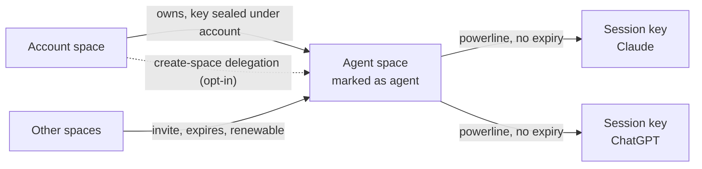
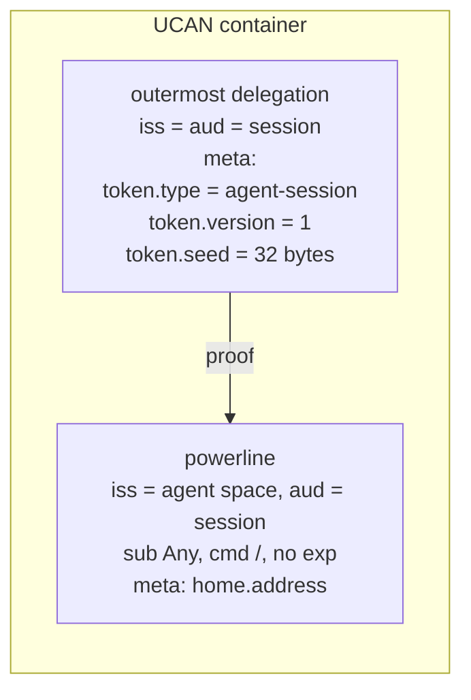
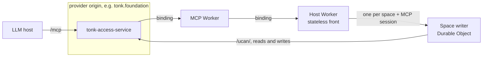
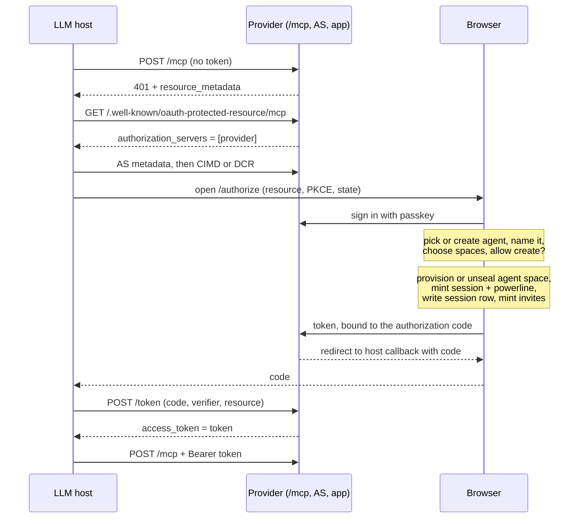
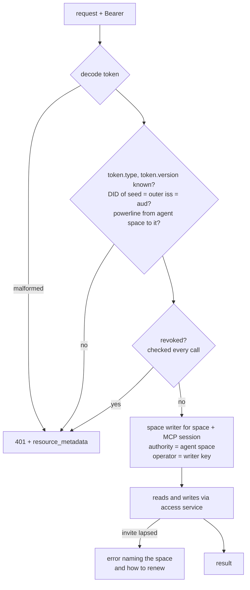
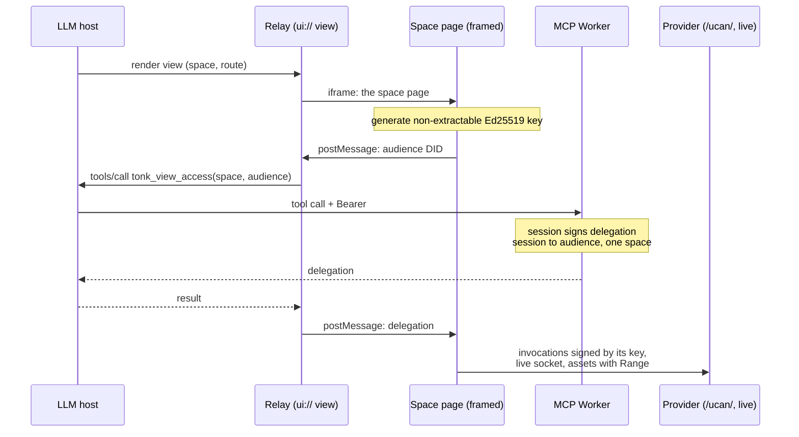
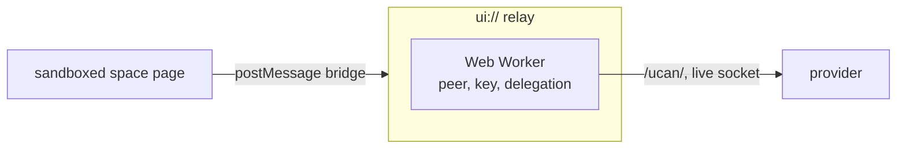
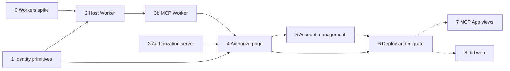

# Hosted agent peer

Status: design agreed 2026-10-28, amended 2026-10-29 after the stage 0 spike
(writes go through one Durable Object per space and MCP session, see
[Writers](#writers)). Stages 0, 1 (first half) and 3 are in review: #1205,
#1202, #1203 and #1204. Replaces the per-call agent-link MCP (#1105).

An agent gets its own space, provisioned by the user's account during an OAuth
sign-up. The OAuth token is a session credential for that space. Every call
carries the token; the handler builds a dialog peer for the agent and acts with
full fidelity: list its spaces, see contacts (the account it works for among
them), query, subscribe, transact, store and read assets, create spaces when
allowed.

Two Workers:

- `/mcp` on the provider origin: MCP, a thin wrapper.
- The Host Worker: the hosted peer, reached by the MCP Worker over a service
  binding. Internal; nothing public routes to it. A stateless front verifies the
  token and hands each request to the space writer, a Durable Object per space
  and MCP session that keeps a warm peer and is the only place that signs
  revisions for it.

Inline views in MCP Apps come later (stage 7). A view is a relay: it gets a
delegation for a key the browser holds and frames the space's own page, so the
page runs the peer in the browser like it does anywhere else.

## Model



- **Agent space.** An ordinary space, provisioned through the user's account and
  sealed under it like any other (dialog-credentials). Accounts are spaces too,
  so an agent space DID is a valid member, audience and contact anywhere an
  account DID is. A space entry marks it as an agent space.
- **Session.** A fresh keypair per OAuth authorization. The agent space delegates
  to it with a powerline (`sub: Any`, command `/`), **no expiry**, the same shape
  as `mint_addressed_device_delegation`. Valid until revoked.
- **Access to other spaces** is by invite to the agent space DID. Invites expire
  and are renewed like any other invite.
- **Space creation** (opt-in at authorization): a delegation from the account
  letting the agent provision spaces on the user's behalf. Created spaces are
  owned by the user and sealed under the account.
- **Attribution.** Authority is the agent space DID. The operator is a writer key
  derived from the session seed and the MCP session id, delegated to by the
  session (see [Writers](#writers)), so each MCP connection writes as its own DID
  and revoking the session cuts every writer under it.
- **Identifier.** `did:key`. Naming agents by `did:web` comes later (stage 8).

### Permanent session delegations

Sessions are deliberately permanent, revoked rather than expired:

- **Expiry lives where it bounds damage.** A session reaches other spaces only
  through invites, and those expire. A leaked token exposes the agent's own space
  plus whatever invites are live.
- **Renewal would need the user.** The agent space key is sealed under the
  account, so only the user's browser can mint a new powerline. Expiring
  sessions mean periodic re-authorization through the LLM host, or a long-lived
  key held server-side for refresh. Neither is better than revocation.
- **Same as devices.** Device authorizations are permanent powerlines too.
- **Revocation is checked on every call** and each session is listed on the
  account page, so a session can be found and cut off.

The token response has no `expires_in` and no `refresh_token`.

## Token

A UCAN container (base64url), the same encoding everything else uses. The
outermost delegation says what the token is and carries the seed:



The outermost delegation is issued by the session to itself, so it authorizes
nothing on its own. The Host Worker reads `token.*` from its `meta`, derives the key
from the seed and checks that its DID is both issuer and audience. Invocations
use only the powerline as proof, and only the powerline is retained in the
agent space (the session row), so the seed is never stored or sent to a
verifier.

## Endpoints



- The channel comes from the host: `tonk.foundation` is main, `staging.tonk.xyz`
  staging, `tonk.network` stable, each PR preview its own. Authorization server
  and resource server are the same origin.
- `tonk-access-service` forwards `/mcp` to the MCP Worker over a service binding.
  The MCP Worker reaches the Host Worker over its own binding. MCP and host deploy
  and scale on their own.
- The app's service worker must let `/mcp` bypass it (next to `/@`), so a tab
  opened on it is not handed the app shell.

### Host Worker API

The contract the MCP Worker calls: what a space's own origin answers
(`tonk-kernel/src/site.rs`, #1201), mounted per space and authorized by the
Bearer token instead of the origin.

| Request | Same as on the space origin |
| --- | --- |
| `/{space}/api/...` | the worker API: query (SSE with `Accept: text/event-stream`), evaluate, transact |
| `PUT /{space}/` | store an asset |
| `GET`/`HEAD /{space}/asset:{hash}` | read an asset, `Range` supported |
| `GET /{space}/{path}` | the content the space's routes keep at `{path}` |

Views do not use it (they run the peer in the browser), so it stays internal. If
it is ever routed publicly on the provider origin, its HTML must carry
`Content-Security-Policy: sandbox` without `allow-same-origin`: that origin holds
the account and its passkeys.

## Authorization

The authorize page is on the provider origin because that is where the user's
passkey works. `/settings/link` (sign-in via another deployment) is the existing
precedent for this kind of approval page.



The browser does all key work. The AS only stores the finished token against the
code. The code is single-use and short-lived; `/token` checks PKCE (S256),
`redirect_uri`, and that `resource` is this origin's `/mcp`, then returns the
token once.

## Request handling



- No container, no replicas, no checkpoints. The front is stateless; the space
  writers hold only caches and an in-memory peer, and the access service holds
  everything durable. Concurrent writes resolve at the revision cell only across
  writers with distinct DIDs (see [Writers](#writers)).
- A verified powerline can be cached by token hash indefinitely. Revocation is
  never cached.
- A lapsed invite is an error naming the space (a tool error through `/mcp`),
  not a 401: a 401 makes the host mint a new session instead of renewing anything.
- Reads go through the access service. Revisit direct R2 only if it measures slow.

## Writers

Dialog assumes each origin is a single sequential actor. An origin is the
branch (subject, profile, branch name) plus the operator DID, and a revision is
identified by `(origin, edition)` without its tree. Two writers that share a DID
and commit on the same head both mint the same version; the second one's pull
takes the first one's head as already seen, its push fast-forwards over it, and
one write is lost with no error. The replicas then never converge
(dialog-db/dialog-db#705). The stage 0 spike hit this: five parallel writes
through one token all returned 200 and one landed.

Concurrent writes from one DID are out of scope. The design makes sure there
never are any:

- **One writer DID per MCP session.** The MCP Worker mints `Mcp-Session-Id` at
  `initialize`, bound by MAC to the token hash so a client cannot pick or reuse
  one. The Host Worker derives the writer key from the session seed and that id,
  and the session delegates to it (the Host Worker holds the seed, so no user is
  needed). Each connection's revisions carry their own origin.
- **One space writer per (space, MCP session)**, a Durable Object, signs every
  revision for that pair. Parallel tool calls in one session are normal (a model
  emits several tool calls in a turn, subagents share a connection, clients
  retry), and Streamable HTTP sends each as its own POST, so writes inside the
  writer take an explicit async lock from commit through push. Durable Object
  input gates do not serialize across `fetch` awaits.
- **The agent space is a space like any other.** Joins, contacts and invites
  land in it, so they go through its own (agent space, MCP session) writer. The
  per-request local peer state is never synced and needs no writer.
- **Different spaces write in parallel.** The origin already includes the
  subject, so one writer key in two space writers never collides.
- **Reads go to the space writer by default**, where dialog's caches stay warm
  (the spike paid 60 to 80 ms per request rebuilding the peer and pulling). They
  do not take the write lock and interleave with writes at I/O waits. CPU does
  not overlap in one Durable Object, so reads are capped in rows and bytes; a
  read over the cap is refused or answered by a stateless isolate instead.
- **A write is answered after its push lands**, so a later read anywhere sees it.
- **The space writer feeds SSE** from the space's `live.rs` socket and fans
  changes out to subscribers.

Rejected: a fresh key per request (every write adds an origin to every context,
forever); a key per isolate (an isolate serves concurrent requests, so it still
needs a lock, and origins grow with isolate churn); one writer per session for
all spaces (needlessly serializes unrelated spaces). Each MCP reconnect still
mints a new origin; that growth is accepted.

### Memory

A Durable Object has the same 128 MB as an isolate, shared by the bundle, the
caches, the peer and the query working set. Wasm linear memory never shrinks, so
a long-lived space writer sits at the high-water mark of everything it has
served. Only the node cache is configurable today (dialog-db/dialog-db#706), so
stage 2 makes an out-of-memory unlikely with the dials that exist, not
impossible:

| Share | Budget | Dial |
| --- | --- | --- |
| Idle isolate (bundle, runtime) | ~2 MiB measured | none |
| Tree node cache | 24 MiB | `HeldCaches::with_budget` |
| Spilled values | 8 MiB per open repository; a space writer opens one space, so 8 to 16 MiB | fixed, keep repositories per writer to one or two |
| Entry caches (causal verdicts, contexts, records, rules, plans) | unmeasured, estimated under 8 MiB | fixed at 2048 entries each |
| Query working set | what is left, about 70 MiB | read caps |
| Margin | ~10 MiB | |

The dials stage 2 uses:

- **Answer caps** in rows and bytes, with paging. Not enough alone: a filter that
  matches 400 of 20k records peaked at 57.8 MiB in the spike with a small answer,
  because the working set is the scan, not the answer.
- **Route big reads away.** A read whose plan scans a whole concept in a space
  above a size threshold goes to a stateless isolate, which starts fresh and is
  thrown away, instead of raising the writer's high-water mark.
- **Recycle on high water.** After each request the writer reads
  `memory.size`; above 96 MiB, and with no write holding the lock, it drops its
  peer and resets itself (`ctx.abort()`), so the next request starts cold
  instead of near the limit.

Remaining risk:

- A read the planner did not see as big still runs in the writer and can push it
  over. The writer is then reset by the runtime: in-flight requests fail with an
  error, and a write that had not pushed is lost but was never acknowledged, so
  the client sees a failure, not silent loss. A retried write follows the
  stage 3b retry rule.
- Contexts are per-origin watermarks, and every MCP reconnect mints an origin, so
  a cached context grows with the space's writer history while the cache count
  stays at 2048. Stage 2 measures the entry caches on a space with many origins;
  if they grow past a few MiB, #706 becomes a blocker rather than a nicety.
- The numbers above come from the spike's 20k-record space. A larger space moves
  the threshold for routing reads away, not the cache budgets.

## Views in MCP Apps (later)

The OAuth token stays in the LLM host; a view never sees it. The view (`ui://`)
is a relay. It frames the space's own page and gets that page a delegation for
a key the page holds. Nothing secret crosses the host.

### Delegating to the frame's key



- **`tonk_view_access(space, audience)`** is app-only (MCP Apps tool
  visibility). The MCP Worker already holds the session seed, so it signs a
  delegation from the session to the frame's DID: one space, read-only unless the
  view writes.
- **The delegation is not a secret.** It is useless without the frame's private
  key, which is generated in the frame, non-extractable, and never leaves it. So
  it can sit in tool results, conversation storage and logs. No `_meta`, no
  fragment secrets, no sealing to an x25519 key (that works too, but delegating
  to the frame's own key moves nothing secret at all).
- **Minted per load.** A reopened conversation reloads the view, which asks again
  for a fresh frame key. The probe shows the view origin is stable per surface,
  so one stored key per surface would also work, but that key is shared by every
  conversation and space on the surface, so each delegation to it reaches all of
  them, and it is orphaned when the origin changes (granting `frameDomains`
  does that). Keep per-load keys unless re-delegation cost shows up.

### Route A: framed page with its service worker

The framed page is the space's ordinary page, on its own origin: the per-space
origin (`https://{hash}.tonk.foundation/...`, #1054) or the existing
`https://tonk.foundation/space/{did}/{route}` shape, extended to take the
delegation by `postMessage` (open question 7). Its service worker and peer run
as they do anywhere, with the delegation as their authority:

- **Live subscriptions** through the space's `live.rs` socket, not a long poll.
- **Media works.** `<video>` streams with real `Range` requests through the
  service worker. Nothing goes through the host as base64.
- **Pages render as they do on the space's own origin.** No view-specific runtime,
  no tool round trip per update, no Host Worker involved.

### Route B: relay runs the peer

If a nested frame cannot keep a real origin or register a service worker, the
relay does what the shell does for sandboxed guests today: it runs the peer
runtime (what the service worker would run) in a Web Worker, and the sandboxed
space page talks to it over `postMessage`, the same bridge `tonk-guest` uses.



- The key is generated in the Web Worker instead of the frame; same tool call.
- Live updates still come over the `live.rs` socket.
- Media: blob URLs or Media Source Extensions from the worker. Large video is a
  follow-up on this route.

### Last resort: long-poll a watch tool

Only if the view cannot reach the provider at all (`connectDomains` not
honoured). No delegation in the view; `tonk_watch(space, query, cursor)`,
app-only, answers when the result moves past `cursor` or after about 20 s. The
MCP Worker holds the call and watches through the space's `live.rs` Durable
Object, whose sockets hibernate between commits. Assets are resource reads,
whole; MCP has no ranges.

## Records

In the agent space, mirroring how the account space records devices:

- **Agent marker.** A space entry marking it as an agent space.
- **Session rows.** Same shape as `account/device-link`: keyed by the powerline's
  blob hash, `created-at`, `title` (OAuth `client_name`, e.g. "Claude"),
  `reason: case:agent-session`. Revoking the powerline removes the row.

New concepts go in the YAML library first (`schema-first`).

## Channels

| Channel | MCP |
| --- | --- |
| main | `https://tonk.foundation/mcp` |
| staging | `https://staging.tonk.xyz/mcp` |
| stable | `https://tonk.network/mcp` |
| PR N | preview origin `/mcp` |

`agent*.tonk.host` (#1110) is retired.

## Implementation

Each stage ends in a milestone that can be shown working on localhost. Stages
0, 1 and 3 can start in parallel; stage 0 gates the architecture of stage 2.



### Stage 0: dialog peer in a Workers isolate

Prove the stateless design before building on it.

- Build a minimal workers-rs Worker embedding the peer (`tonk-worker` already
  targets `wasm32` for the browser). Hardcode a seed and powerline.
- Through the access service: list spaces, query, subscribe, evaluate, store and
  read an asset.
- Measure compressed bundle size against the Workers limit, peak memory against
  128 MB, cold start, and CPU on the largest real space we have.

**M0:** go/no-go with numbers. Fallback if no-go: a container, stateless per
call (no replicas or checkpoints), and revisit.

Done in #1205 (`plans/2026-10-29-hosted-agent-peer-spike.md`): conditional go
on the paid plan, no-go on free. 5.0 MiB gzip; 60 to 80 ms per warm request
rebuilding the peer; every listed operation works. Its three conditions shaped
[Writers](#writers): bound reads (a full scan of 20k records peaked at 231 MiB),
no concurrent writers on one DID, and feed SSE from `live.rs`.

### Stage 1: identity primitives

Rust, in `tonk-identity`, `tonk-schema` and the YAML library.

- Concepts: agent marker and `agent-session` row (mirror `account/device-link`).
- `mint_agent_session(agent_space, session_did, home)`: powerline, no expiry.
- Token as a UCAN container: outermost session-to-session delegation with
  `token.type`, `token.version`, `token.seed` in `meta`, the powerline as its
  proof. Tests: round trip; unknown type or version refused; seed DID must match
  issuer and audience; the retained powerline and the proofs sent on invocation
  never contain the seed.
- Provision an agent space under an account (reuse space creation and sealing).
- Create-space delegation, once open question 1 is decided.
- CLI: `tonk agent create --name`, `tonk agent session` printing a token,
  `tonk agent revoke`. This gives later stages real tokens without OAuth.

**M1:** from the CLI, create an agent, invite it to a space, mint a token,
decode and verify it, revoke it.

The concepts, `mint_agent_session` and the token codec are in #1202. The CLI
and provisioning wait on open question 9: minting the powerline needs a signer
for the agent space key, which dialog-peer does not hand out.

### Stage 2: Host Worker and space writers (internal)

- Front: decode, verify, revocation check, then route by (space, MCP session)
  to the space writer.
- Space writer (Durable Object): derive the writer key from the seed and the
  MCP session id and delegate to it from the session; open the peer with the
  dialog node cache budgeted; serialize writes with an async lock held from
  commit through push; answer a write after its push lands.
- Serve the Host Worker API per space: worker API with SSE, `PUT` assets,
  `asset:{hash}` with `Range`, route content. Reuse the kernel's rewrite onto the
  worker's routes rather than reimplementing it.
- Cap read answers in rows and bytes and page large ones; a read-only evaluate
  does not compute its matches twice.
- SSE subscriptions are fed by the space writer from the space's `live.rs`
  socket, not by polling.
- Agent-level reads: the agent's spaces and contacts.
- Skip the per-request profile bootstrap commits and the `/library/profile.yaml`
  fetch the spike saw.
- Tests: missing, malformed, wrong-audience and revoked tokens; parallel writes
  through one MCP session all land; parallel writes from two MCP sessions both
  land; no read path publishes a revision; a read over the cap is refused; a
  lapsed invite; a `Range` read; an SSE subscription receiving a change.

**M2:** locally (`wrangler dev`), with a CLI token and `curl`: list the agent's
spaces, subscribe to a query over SSE, write from a second shell and see the
event, store and range-read an asset.

### Stage 3: authorization server

On the access service (Rust).

- `/.well-known/oauth-protected-resource/mcp` naming this origin.
- `/.well-known/oauth-authorization-server`: `code_challenge_methods_supported:
  [S256]`, `client_id_metadata_document_supported: true`, `registration_endpoint`.
- Client ID Metadata Documents and dynamic registration. Accept
  `http://localhost:<port>` callbacks. Pre-#1105 `mcp/hosted/oauth.mjs`,
  `registration.mjs` and `cloudflare/discovery.mjs` are reference.
- `/authorize`: validate, then hand off to the app route (stage 4).
- Code store: single use, short TTL, holding the token, PKCE challenge,
  `redirect_uri`, `resource`. If D1, a migration plus the `control-schema` doc.
- `/token`: check PKCE, `redirect_uri`, `resource`; return the token once.
- Tests: replayed code, wrong verifier, wrong resource, wrong redirect, expired code.

**M3:** MCP Inspector completes discovery and the OAuth dance against the local
stack using a stub approval page that returns a CLI-minted token.

In review as #1203 (metadata, registration) and #1204 (authorize, code store,
token). Registration is stateless (an HMAC'd `client_id`), tokens are sealed at
rest, and the approval page is expected at `/settings/agent?request=<handle>`.
M3 itself has not been run yet.

### Stage 3b: MCP Worker (`/mcp`)

Replaces `mcp/agent-link-backend.mjs`, `mcp/hosted/agent-service.mjs` and the
container.

- Bearer token passed through to the Host Worker over the binding, with the
  MCP session id.
- Mint `Mcp-Session-Id` at `initialize`, bound by MAC to the token hash, and
  refuse an id that does not verify.
- Tool contract: a write may be retried after a space writer restart, so writes
  carry an idempotency key or say they are not idempotent.
- Tools: `tonk_query` and `tonk_evaluate` addressed by `space` instead of
  `agent_link`; list spaces; contacts; join from a pasted ticket; create space
  when delegated. Keep `mcp/primitive.mjs` notation semantics.
- `401` with `WWW-Authenticate: Bearer resource_metadata=...`; tool errors for
  lapsed invites.
- Service binding from `tonk-access-service`; service worker bypass for `/mcp`.

**M3b:** Claude Code against the local stack with the CLI token as a static
header (`claude mcp add --transport http --header "Authorization: Bearer ..."`)
lists spaces, queries and writes in a space the agent was invited to.

### Stage 4: authorize page

In `tonk-ui` on the provider origin, modelled on `/settings/link`.

- Sign in with passkey. Show the client name **and the redirect host** (the spec
  requires showing the host; localhost-only callbacks get a warning).
- New or existing agent; name; choose spaces; allow space creation.
- On approve, the browser steps from Authorization, then post the token to the
  AS bound to the code.
- Playwright with Chrome's virtual authenticator (`hasPrf: true`).

**M4:** Claude Code runs the real flow on localhost: browser opens, user approves,
tools work, with no static header.

### Stage 5: account management

- List agents and their sessions (title, created, last used); revoke a session;
  revoke an agent (all sessions); manage its invites; toggle space creation.
- Last used: throttled write from the Host Worker, at most once a day per session.
- Renewal of an agent's lapsed invites, per open question 4.

**M5:** revoking a session on the account page makes its next call return 401;
revoking an agent does so for all its sessions.

### Stage 6: deploy and migrate

- Deployment config: MCP Worker bound into each channel's access service, Host
  Worker bound to it, the space writer Durable Object bound to the Host Worker.
  Drop the container, the `TonkRuntime` Durable Object (the space writer replaces
  it), the checkpoint buckets and the `agent*.tonk.host` custom domains.
- Smoke: PRM served, 401 carries `resource_metadata`, AS metadata reachable, a
  CLI-minted token for a fixture agent can query through `/mcp`.
- Agent-link callers: tools still sent `agent_link` get an error telling them to
  reconnect with OAuth. Remove the agent-link backend after one release.
- Acceptance on `tonk.foundation`: claude.ai, Claude Code, ChatGPT. Then staging,
  then stable.

**M6:** claude.ai connected to `tonk.foundation/mcp` through the real OAuth flow,
working in a space it was invited to.

### Stage 7 (later): MCP App views

Wanted, not needed for the core flow. Starts with a probe that picks the route.

**Probe.** A throwaway MCP server whose view is a relay framing a test page on a
separate origin. Run in Claude (web and desktop) and ChatGPT; VS Code and Goose
if cheap. The pages report:

Route A
- the nested frame loads (`frameDomains` honoured, our `frame-ancestors` allows
  the host's view origin);
- it has a real origin, not `null` (sandbox flags the host passes down);
- a service worker registers (partitioned) and controls the page;
- WebCrypto makes a non-extractable Ed25519 key and keeps it in IndexedDB;
- `postMessage` between relay and frame both ways;
- `fetch` and a WebSocket to the provider from the frame;
- a `<video>` plays and seeks through the service worker, with `206` responses.

Route B
- the relay can start a Web Worker (`worker-src`);
- `fetch` and a WebSocket to the provider from it (`connectDomains`).

Both
- view-initiated tool calls are allowed, approved once rather than per call, and
  not queued behind the model;
- for the last resort only: a 20 s tool call survives.

**Probe results** (2026-10-29, custom connector, probe at
`sw-probe.irakli-1ed.workers.dev`, raw reports under `/reports`):

| Check | Claude web | Claude desktop | ChatGPT web |
| --- | --- | --- | --- |
| `frameDomains` honoured | no (`[]`, `frame-src` blocked) | no | yes |
| Route A frame: real origin, SW controls page, IndexedDB key, `fetch` + WebSocket | not reached | not reached | pass (SW partitioned under `chatgpt.com`) |
| Route A `<video>` through SW, 206 + seek | not reached | not reached | pass |
| Route B blob Web Worker, secure context, non-extractable Ed25519 | pass | pass | pass |
| `fetch` + `wss` to provider (`connectDomains`) | pass | pass | pass |
| View-initiated app-only tool calls | pass, ~450 ms, no prompt | pass, ~450 ms | pass, ~690 ms |

- Route B is the only route that covers Claude today; route A works only in
  ChatGPT. Claude sends `frame-src` in two cases only: a directory connector
  whose listing declares `frameDomains` (bare https origins) and whose installed
  URL matches the listing exactly, or a custom connector behind rollout flags,
  never in the Code tab. So route A in Claude waits on directory review.
- `frame-src` is hashed into the view's origin, so granting `frameDomains` later
  changes the origin and orphans anything the view stored.
- The view's CSP allows `frame-src blob: data:`; blob and `srcdoc` frames load
  and share the view's IndexedDB, which suits route B. No service worker can
  register on the view's origin: that host serves only `/mcp_apps` and 404s
  everything else.
- The view origin is real and stable per surface (`{hash}.claudemcpcontent.com`,
  a different hash on web and desktop), with working IndexedDB. The relay can
  keep one key per surface instead of minting one per load (see "Minted per load").
- No approval prompt for view-initiated calls in Claude, so `tonk_view_access`
  does not nag.
- Not covered yet: the 20 s tool call, key persistence across reloads, VS Code,
  Goose, mobile and ChatGPT desktop.

Build route B first. Route A is a ChatGPT-only extra, and it is the only route
that plays and seeks video through a service worker, so M7's video check
applies to ChatGPT only unless route B finds another way to serve ranged assets.

**Then:**

- `tonk_view_access(space, audience)`, app-only, signing a one-space delegation
  to the frame's (or worker's) key. Read-only by default.
- Route A: the space page accepts a delegation by `postMessage` when framed.
- Route B: relay with the peer runtime in a Web Worker and the guest bridge.
- Last resort: `tonk_watch` in the MCP Worker over `live.rs`.

**M7:** in Claude and ChatGPT, a tool renders a live view of a space; a write from
the CLI shows up in the view without a model turn. On route A, a video asset
plays and seeks.

### Stage 8 (later): did:web identifiers

```
did:key:z6Mk...                       agent space key
did:web:tonk.network:agent:z6Mk...
  └─ GET https://tonk.network/agent/z6Mk.../did.json
```

Same pattern as `did:web:tonk.network:customer:...`, so each channel names its
own agents. The document is derived from the key: one `verificationMethod` for
the embedded key, `alsoKnownAs` the `did:key`, a `service` entry for `/mcp`.

- Resolvers **must** check that the document's key is the one embedded in the
  identifier, so whoever controls the host cannot rotate an agent's key. The
  access service already verifies chains from `did:web` issuers
  (`dialog_did_web::CachingResolver`); the embedded-key check is new.
- Serve `/agent/{key}/did.json`, with a deactivated flag for revoked agents.
- Decide whether existing agents are renamed or keep `did:key`.

**M8:** an invite addressed to an agent's `did:web` verifies, and the document
resolves with the embedded-key check enforced.

## Local development

| Piece | How |
| --- | --- |
| Access service, AS, app | `wrangler dev`; see the `run-app` skill |
| Host and MCP Workers, space writer | `wrangler dev` (Durable Objects run locally), bound to the access service locally |
| Real client | `claude mcp add --transport http tonk-local http://localhost:<port>/mcp` |
| Step-through | `npx @modelcontextprotocol/inspector` |
| Automated | Playwright + Chrome virtual authenticator, Node MCP SDK client |
| claude.ai | `cloudflared tunnel --url` for the access service; passkeys are per tunnel hostname |

## Open

1. **Create-space delegation.** Narrow command or powerline from the account?
   Quota? Permanent and unbounded means a leaked token can create spaces the
   user pays for. Blocks the last item of stage 1.
2. **Finding agents.** Does the account page list agent spaces from the account's
   space list filtered by the marker, or keep a pointer in the account space?
   Decides whether agents show up among ordinary spaces. Needed by stage 5.
3. **Workers fit.** Answered by stage 0 (#1205): conditional go, see
   [Writers](#writers).
4. **Invite renewal.** Who renews an agent's lapsed invite, and how the agent
   learns which one lapsed. Needed by stage 5.
5. **Kernel site surface.** The Host Worker API mirrors `site.rs` from #1201, which
   is not merged. Stage 2 follows whatever lands.
6. **`did:web` as principal or alias.** As principal, the powerline issuer,
   invite audiences and contacts use the `did:web`, and every verifier resolves
   it. As alias, UCANs keep the `did:key`. Does the space's storage subject stay
   `did:key` either way? Needed by stage 8.
7. **Framed page URL.** The per-space origin (`{hash}.tonk.foundation`, #1054)
   or `tonk.foundation/space/{did}/{route}` extended to accept a delegation. The
   per-space origin keeps space content off the origin that holds passkeys.
   Needed by stage 7.
8. **View delegation scope.** Read-only by default; do any views need to write?
   Lifetime matters less because the private key never leaves the frame.
9. **Signing as the agent space key.** Minting the session powerline needs the
   agent space key as a signer, in the CLI and in the authorize page.
   dialog-peer only signs as the profile and does not open held keys. Options: a
   dialog-peer API that delegates as a held principal (preferred), reaching
   into dialog's key storage from tonk, or minting through the account chain
   (breaks the model). Blocks the rest of stage 1 and stage 4.
10. **Cache budgets.** Only dialog's node cache takes a budget; spilled values
    are 8 MiB per repository and the rest are capped by entry count
    (dialog-db/dialog-db#706). Needed to size the space writer under 128 MB.
11. **Same-version detection in dialog.** Out-of-model concurrent writers should
    fail loudly, not lose writes (dialog-db/dialog-db#705). The design avoids
    them; the fix is defence in depth.
