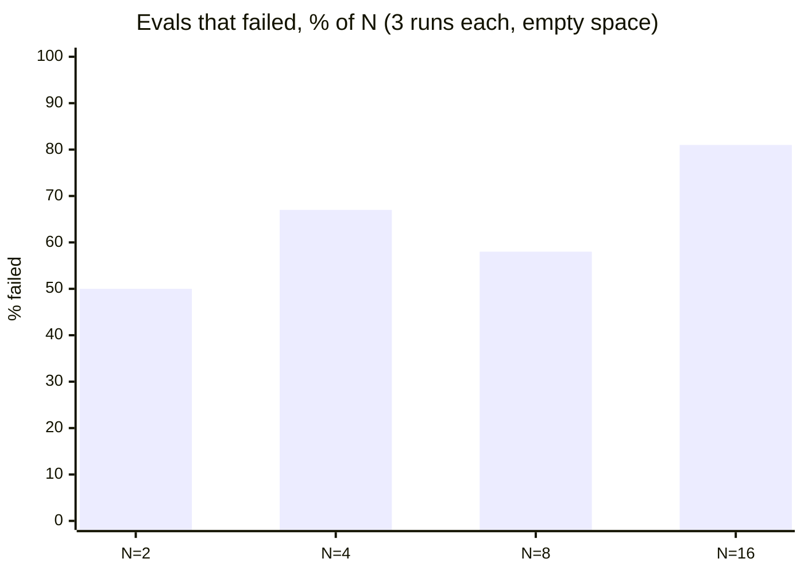

# 2026-11-24: N concurrent evals on one replica, no upstream

Harness scripts, experiment patches and per-run rows are not kept in the
repository; they are at [`9e36f0e`](https://github.com/tonk-labs/tonk/tree/9e36f0e/research/concurrent-cli-writes) (`harness/`, `results/`), on the
`research/concurrent-cli-writes-artifacts` branch.

tonk `c0ec36e`, `cargo build -p tonk-cli` (dev profile), Linux, 4 cores.
Harness: `harness/run.sh`, three rounds, N interleaved 2, 4, 8, 16 within
each round. Each run starts from a fresh replica (`space new` + one
concept); each writer asserts one distinct note with `--no-sync`.

| N | succeeded (r1, r2, r3) | failed: version mismatch | failed: head lock held | other | exit 0 but not in final head | median eval ms |
|---|---|---|---|---|---|---|
| 2 | 1, 1, 1 | 2 | 1 | 0 | 0 | 29-34 |
| 4 | 2, 1, 1 | 8 | 0 | 0 | 0 | 27-34 |
| 8 | 3, 4, 3 | 12 | 2 | 0 | 0 | 50 |
| 16 | 4, 3, 2 | 25 | 14 | 0 | 0 | 92-99 |

Every failure was at commit, with exit 4:

- `commit failed: Failed to publish new revision: Version mismatch: expected …, found …` (47)
- `commit failed: Failed to publish new revision: Storage error: Lock error: Concurrent write in progress (lock …/memory/branch/main/revision.lock held)` (17), the error BUG-350 reports.

A second error printed as a warning, 22 times:
`warning: could not retain revision for checkout: Storage error: Lock error: … (lock …/memory/tonk/revisions/version/<n>@….lock held)`.
6 of those were on evals that exited 0: their revision committed and is
not retained for checkout. The other 16 were on evals whose own commit
then failed, which means those processes had published a branch head
earlier in the same run (`account_authority.rs:343-372` retains only after
a publish succeeds). Run sequentially, one eval publishes one head.

Ten sequential evals on an empty space, each a fresh process: 28, 29, 30, 30, 31, 31, 32, 32, 35, 36 ms (median 31).

## Where a cold eval's time goes

Empty space, dev profile, 15 runs each, ms:

| command | min | median | max |
|---|---|---|---|
| `/bin/true` | 1.8 | 2.3 | 4.5 |
| `tonk --version` | 3.9 | 4.2 | 7.8 |
| `tonk eval` read | 22.8 | 25.1 | 27.2 |
| `tonk eval` write | 23.8 | 26.2 | 39.0 |
| `tonk eval --dry-run` write | 21.1 | 25.2 | 32.1 |

A write costs about what a read does, so the commit is not where the time
goes; opening the space is the suspect, not yet profiled.

## Does a big writer starve under retry?

`harness/starve.sh`: one eval of K notes in one document against 8 small
writers that commit one note each, in a loop with no pause, until the big
one is done. **retry**: a writer that exits 4 runs its eval again at once,
the big one up to 64 times (the document re-run, a fresh process per
attempt). **queue**: every eval runs under a blocking `flock` on one file.
Three rounds, policies and K interleaved.

Alone, the big eval takes 60 ms (K = 50), 220 ms (500), 1484 ms (2000).

| K | policy | big landed (r1, r2, r3) | big attempts | big wall ms |
|---|---|---|---|---|
| 50 | retry | no, yes, no | 64, 55, 64 | 7615, 6094, 7890 |
| 50 | queue | yes, yes, yes | 1, 1, 1 | 318, 360, 370 |
| 500 | retry | no, no, no | 64, 64, 64 | 31442, 21219, 27481 |
| 500 | queue | yes, yes, yes | 1, 1, 1 | 444, 496, 434 |
| 2000 | retry | no, no, no | 64, 64, 64 | 156778, 127520, 148139 |
| 2000 | queue | yes, yes, yes | 1, 1, 1 | 1241, 1256, 1804 |

Under retry the big eval lost 553 of 556 attempts: 3 lost at the head
lock, the rest by version mismatch.

What this does not show:

- **A realistic load.** The small writers commit back to back with no
  think time, about as often as the machine allows. Agents commit once a
  turn, seconds apart; at that rate a short eval mostly wins. The result
  is that starvation exists at saturation, not how often agents reach it.
- **dialog's in-process retry.** Each attempt here pays a process start
  (~25 ms); `Branch::transact` re-runs in one process, a shorter window,
  but the big eval's own evaluation (60-1500 ms) is most of its window.
- **Throughput.** The small writers' counts end when the big one does, so
  they are not comparable between policies. Under the queue a small eval
  waited a mean of 524 ms (K = 2000, r1) against 71 ms under retry.

## Block store against Chronicle

Second sitting. tonk built twice from the same commit: as on main (a file
per block and per cell), and with every space in one dialog-chronicle file
(`harness/chronicle-space.patch`: tonk's `NativeSpace` becomes
`Space<Chronicle, Chronicle, FileSystem, FileSystem, FileSystem>`). The two
interleaved within each round; three rounds.

| N | fs: failed | fs: version mismatch / lock | Chronicle: failed | Chronicle: version mismatch / lock | lost (both) |
|---|---|---|---|---|---|
| 2 | 2 of 6 (33%) | 2 / 0 | 2 of 6 (33%) | 2 / 0 | 0 |
| 4 | 7 of 12 (58%) | 6 / 1 | 5 of 12 (42%) | 5 / 0 | 0 |
| 8 | 17 of 24 (71%) | 16 / 1 | 15 of 24 (62%) | 15 / 0 | 0 |
| 16 | 41 of 48 (85%) | 29 / 12 | 32 of 48 (67%) | 32 / 0 | 0 |

"Could not retain revision for checkout" warnings: 15 on fs, 0 on
Chronicle.

Cold eval, empty space, 15 sequential runs each, ms: fs 25.4-40.4, median
32.0; Chronicle 25.1-41.1, median 31.0.

Starvation, K = 500 against 8 back-to-back writers, three rounds each:

| backend | retry: big landed | retry: big wall ms | queue: big landed | queue: big wall ms |
|---|---|---|---|---|
| fs | 0 of 3 | 30184, 20818, 27904 | 3 of 3, first try | 333, 541, 487 |
| Chronicle | 0 of 3 | 27495, 28846, 25853 | 3 of 3, first try | 397, 386, 459 |

On Chronicle a writer waits for the file's turn, so no eval is refused at
the lock and none misses the checkout index; a moved head is still a
failed eval. Cold start on an empty space is the same on both; whether
reading in place from the file changes it on a space of realistic size is
not measured.
