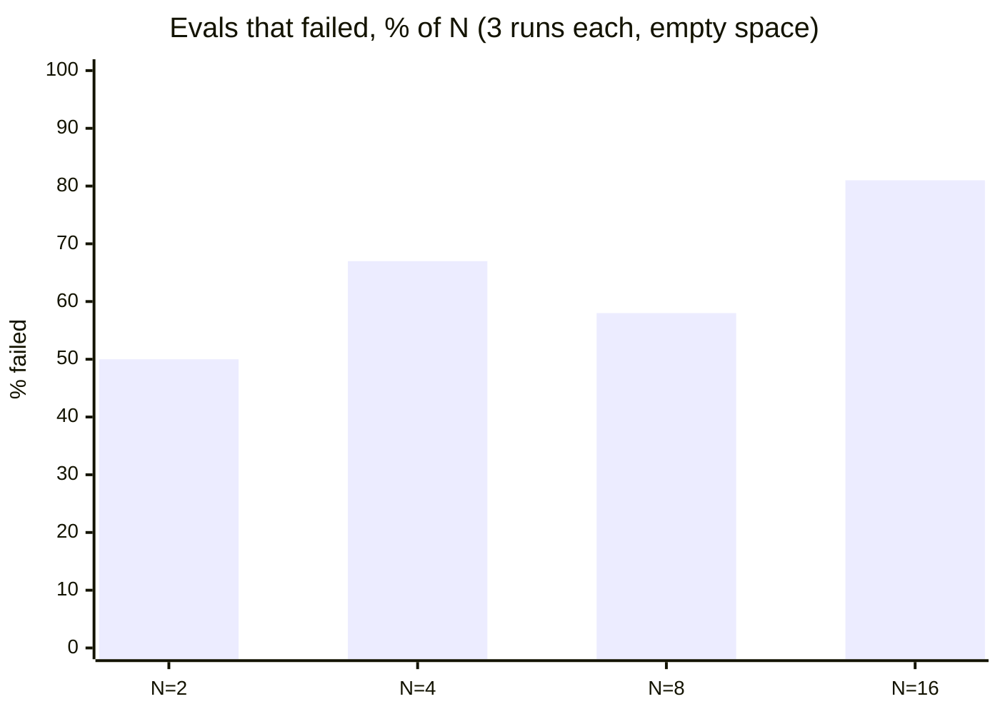

# 2026-11-24: N concurrent evals on one replica, no upstream

tonk `c0ec36e`, `cargo build -p tonk-cli` (dev profile), Linux, 4 cores.
Harness: `harness/run.sh`, three rounds, N interleaved 2, 4, 8, 16 within
each round. Each run starts from a fresh replica (`space new` + one
concept); each writer asserts one distinct note with `--no-sync`. Per-run
rows (writer, exit code, error kind, landed, ms) are in `r<round>-n<N>.tsv`.

| N | succeeded (r1, r2, r3) | failed: version mismatch | failed: head lock held | other | exit 0 but not in final head | median eval ms |
|---|---|---|---|---|---|---|
| 2 | 1, 1, 1 | 2 | 1 | 0 | 0 | 29-34 |
| 4 | 2, 1, 1 | 8 | 0 | 0 | 0 | 27-34 |
| 8 | 3, 4, 3 | 12 | 2 | 0 | 0 | 50 |
| 16 | 4, 3, 2 | 25 | 14 | 0 | 0 | 92-99 |

Every failure was at commit, with exit 4:

- `commit failed: Failed to publish new revision: Version mismatch: expected …, found …` (47)
- `commit failed: Failed to publish new revision: Storage error: Lock error: Concurrent write in progress (lock …/memory/branch/main/revision.lock held)` (17), the error BUG-350 reports.

A second error printed as a warning, 22 times:
`warning: could not retain revision for checkout: Storage error: Lock error: … (lock …/memory/tonk/revisions/version/<n>@….lock held)`.
6 of those were on evals that exited 0: their revision committed and is
not retained for checkout. The other 16 were on evals whose own commit
then failed, which means those processes had published a branch head
earlier in the same run (`account_authority.rs:343-372` retains only after
a publish succeeds). Run sequentially, one eval publishes one head.

Ten sequential evals on an empty space, each a fresh process: 28, 29, 30, 30, 31, 31, 32, 32, 35, 36 ms (median 31).

## Where a cold eval's time goes

Empty space, dev profile, 15 runs each, ms:

| command | min | median | max |
|---|---|---|---|
| `/bin/true` | 1.8 | 2.3 | 4.5 |
| `tonk --version` | 3.9 | 4.2 | 7.8 |
| `tonk eval` read | 22.8 | 25.1 | 27.2 |
| `tonk eval` write | 23.8 | 26.2 | 39.0 |
| `tonk eval --dry-run` write | 21.1 | 25.2 | 32.1 |

A write costs about what a read does, so the commit is not where the time
goes; opening the space is the suspect, not yet profiled.
