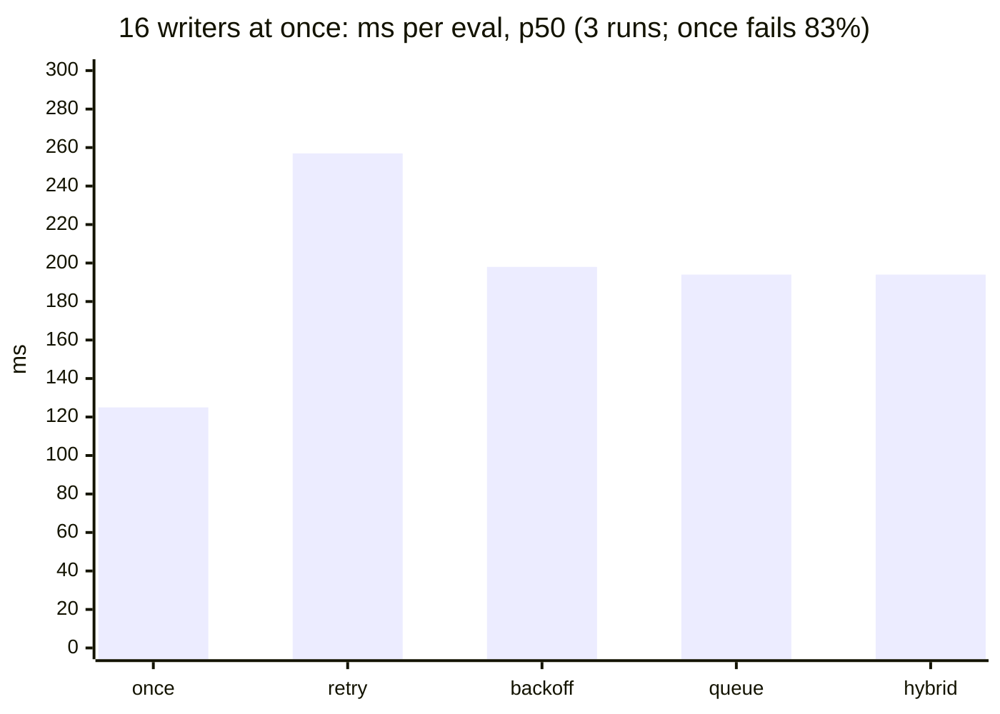

# 2026-11-25: how an eval handles a lost race

tonk `c0ec36e` plus `harness/eval-policies.patch` (dev profile, file per
block, 4 cores). `TONK_EVAL_POLICY` picks the policy: **once** (main),
**retry** (evaluate again over the new head at once, up to 64 tries),
**backoff** (as retry, after a jittered pause of 2-128 ms), **queue** (a
machine-wide `flock` on the space from read to publish), **hybrid**
(evaluate without the lock, publish under it; queued after one loss).
Policies interleaved within each N and round; three rounds; nothing else
ran. Rows in `policies/`.

## Concurrent small writes

Each cell: failed of total; ms per eval p50 / p95; most tries one eval
took. No run lost a write that reported success.

| N | once | retry | backoff | queue | hybrid |
|---|---|---|---|---|---|
| 2 | 3 of 6; 41 / 45 | 0 of 6; 42 / 46; 3 tries | 0 of 6; 46 / 53; 2 | 0 of 6; 47 / 54; 1 | 0 of 6; 50 / 62; 2 |
| 4 | 7 of 12; 38 / 48 | 0 of 12; 46 / 60; 5 | 0 of 12; 54 / 74; 4 | 0 of 12; 54 / 74; 1 | 0 of 12; 48 / 73; 2 |
| 8 | 17 of 24; 66 / 95 | 0 of 24; 84 / 112; 9 | 0 of 24; 88 / 121; 5 | 0 of 24; 92 / 130; 1 | 0 of 24; 94 / 148; 2 |
| 16 | 40 of 48; 125 / 147 | 0 of 48; 257 / 336; 17 | 0 of 48; 198 / 368; 8 | 0 of 48; 194 / 293; 1 | 0 of 48; 194 / 287; 2 |

## A long eval against back-to-back writers

One eval of 500 notes (alone: ~220 ms) against 8 writers committing in a
loop with no pause, every eval under the same policy.

| policy | long eval landed | its wall ms (r1, r2, r3) | small evals failed |
|---|---|---|---|
| retry | 0 of 3: 64 tries spent | 32152, 33569, 30171 | 0 |
| backoff | 0 of 3: 64 tries spent | 23723, 23277, 22717 | 0 |
| queue | 3 of 3, first try | 272, 275, 274 | 0 |
| hybrid | 3 of 3 | 700, 692, 546 | 0 |

## A write in a process that stays open

Same replica shape; 15 commits each in its own process, then 30 commits in
one process (`TONK_EVAL_WARM`). ms:

| round | cold, own process: median (min-max) | warm: first in process | warm: the rest, median (min-max) |
|---|---|---|---|
| 1 | 36.2 (34.1-53.1) | 19.8 | 8.8 (7.3-15.3) |
| 2 | 35.4 (33.4-45.2) | 16.0 | 7.7 (7.0-12.7) |
| 3 | 36.5 (33.3-44.1) | 20.3 | 8.1 (7.2-58.2) |

## Against the bars

- **once, retry, backoff fail**: once at every N; retry and backoff spend
  their 64 tries on the long eval in every run.
- **queue and hybrid pass**: zero failures, zero lost, in every run.
- Between the two, queue was as fast or faster on every measure, and its
  long eval landed in ~275 ms against hybrid's 550-700 (hybrid's long eval
  loses once before it queues). Hybrid's advantage, evaluating in parallel
  outside the lock, would need evaluations long relative to the publish
  and few conflicts; these runs have neither.

Not covered: writers that do not take the lock (sync's pulls,
`Branch::transact` users in the CLI, other tools) still move the head
under a queued eval, which then evaluates again (up to 3 tries here).
